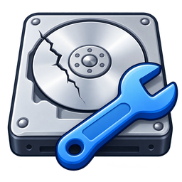
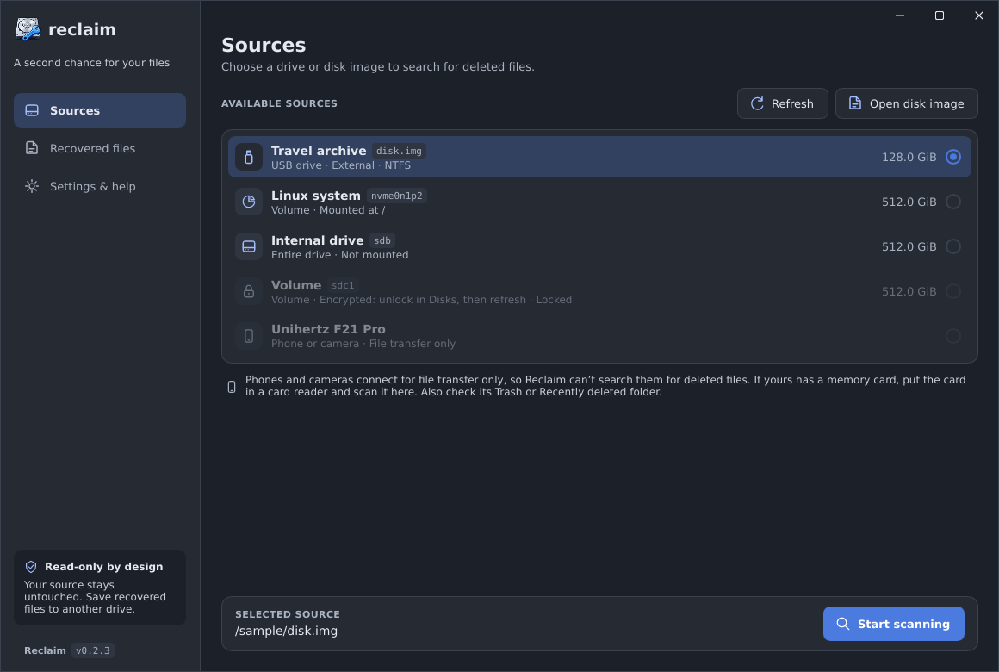
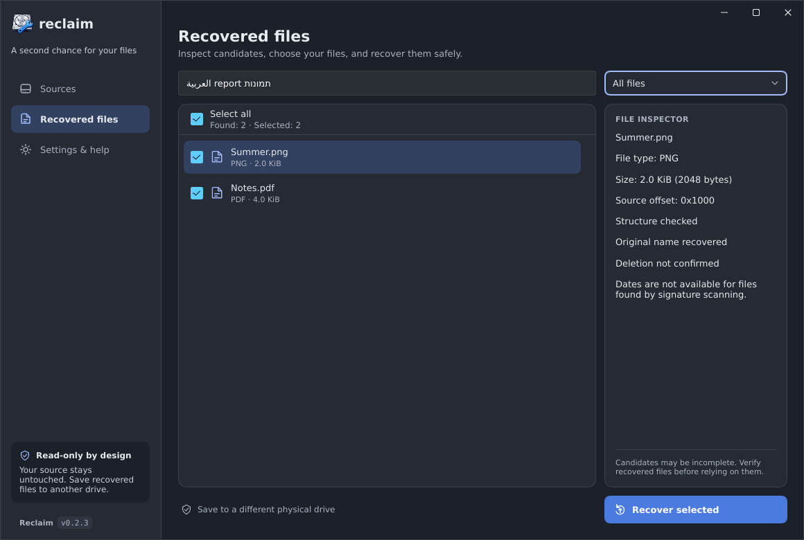

<div align="center">
  
  <h1>Reclaim</h1>
  <p><strong>Get back deleted photos, documents and other files.</strong></p>
  <p>Free, open source, and it never changes the drive it scans.<br>For Windows, macOS and Linux, in 7 languages.</p>

[**Download Reclaim**](#download) · [Lost files just now?](#lost-files-just-now-do-this-first) · [How to recover](#how-to-recover-your-files) · [Problems and fixes](#problems-and-fixes)

[](https://github.com/sudo-py-dev/reclaim/releases/latest)
[](https://github.com/sudo-py-dev/reclaim/actions/workflows/build.yml)
[](LICENSE)

</div>



## Lost files just now? Do this first

A deleted file usually stays on the drive until something new is written on top of it. Every save, download, install or update can take that space. So, **before anything else:**

- **Files were on a memory card, USB stick or external drive?** Unplug it. Don't take new photos with it, and if your computer or camera offers to format it, say **no**. You can then install Reclaim on your computer as usual.
- **Files were on your computer's main drive (for example `C:` on Windows)?** Don't install anything on it. On another computer, download the **portable ZIP** (see [Download](#download)) straight to a USB stick, unzip it there, and run Reclaim from the stick. Reclaim still saves a small settings file and log on the main drive, but this keeps new writes to a minimum.
- **Always save recovered files to a different drive** from the one you are recovering. Saving to the same drive can overwrite files you haven't recovered yet.

### Will Reclaim work for me?

| Your situation | Can Reclaim help? |
| --- | --- |
| SD card, camera card or USB stick | **Usually yes.** These usually use FAT32 or exFAT, which Reclaim reads. |
| External hard drive | **Yes**, if it's formatted as NTFS, FAT32, exFAT, ext2, ext3, ext4 or HFS+ (Mac OS Extended). |
| Windows computer's internal drive | **Yes** for hard drives. For SSDs, chances are low (see [SSDs](#why-are-ssds-different)). |
| Your Mac's built-in drive | **Not yet** on current Macs, which use APFS. Older Macs and external drives formatted as **Mac OS Extended (HFS+)** work. Memory cards and USB drives used on a Mac are fine. |
| Linux drive | **Yes** for ext2, ext3 and ext4. **Not yet** for Btrfs or XFS. On an SSD, chances are low (see [SSDs](#why-are-ssds-different)). |
| Windows Server or Dev Drive using ReFS | **Not yet.** Reclaim recognizes ReFS but can't read it yet. |
| Files that were overwritten | **No.** No software can bring back data that new files have replaced. |

Reclaim is an **early preview**, and no recovery tool can promise every file will come back.

## Download

Pick the file for your computer from the **[latest release](https://github.com/sudo-py-dev/reclaim/releases/latest)**:

| Computer | Normal install | Portable (no install) |
| --- | --- | --- |
| **Windows** (64-bit) | [Windows installer (`.exe`)](https://github.com/sudo-py-dev/reclaim/releases/latest/download/reclaim-windows-x86_64-setup.exe) | [ZIP](https://github.com/sudo-py-dev/reclaim/releases/latest/download/reclaim-windows-x86_64.exe.zip) |
| **Mac with Apple chip** (M1, M2, M3…) | [Apple Silicon installer (`.pkg`)](https://github.com/sudo-py-dev/reclaim/releases/latest/download/reclaim-macos-aarch64.pkg) | [ZIP](https://github.com/sudo-py-dev/reclaim/releases/latest/download/reclaim-macos-aarch64.zip) |
| **Mac with Intel chip** | [Intel installer (`.pkg`)](https://github.com/sudo-py-dev/reclaim/releases/latest/download/reclaim-macos-x86_64.pkg) | [ZIP](https://github.com/sudo-py-dev/reclaim/releases/latest/download/reclaim-macos-x86_64.zip) |
| **Ubuntu / Debian** (64-bit) | `.deb` package from the [release page](https://github.com/sudo-py-dev/reclaim/releases/latest) | [ZIP](https://github.com/sudo-py-dev/reclaim/releases/latest/download/reclaim-linux-x86_64.zip) |

**Not sure which Mac you have?** Open the Apple menu (top-left corner) → **About This Mac**. If it says **Chip: Apple M…**, choose Apple Silicon. If it says **Processor: Intel**, choose Intel.

### Installing

- **Windows:** run the installer. It adds Reclaim to the Start menu and includes an uninstaller. If Windows shows *"Windows protected your PC"*, click **More info**, then **Run anyway**.
- **Mac:** open the `.pkg` file to install Reclaim in Applications. Reclaim isn't notarized by Apple yet, so the first time macOS may block it. Go to **System Settings → Privacy & Security**, scroll down and click **Open Anyway**.
- **Ubuntu / Debian:** open a terminal in the folder you downloaded the file to and run the command below, using the version number in your file name. It needs Ubuntu 22.04, Debian 12 or newer.

  ```sh
  sudo apt install ./reclaim_0.2.3_amd64.deb
  ```
- **Portable ZIP:** unzip it into a folder (or onto a USB stick) and run the `reclaim` program inside. On Mac and Linux you may first need to run `chmod +x reclaim-*` in that folder.

## How to recover your files

1. **Choose the drive** where the files were. Connected drives appear on their own; click **Refresh** after plugging one in. If the drive is encrypted (BitLocker, FileVault, LUKS), unlock it first.
2. **Click Start scanning.** Files appear while the scan runs. You can recover them right away, without waiting for the scan to finish, or stop the scan as soon as you see what you need.
3. **Look through the results.** Search by name or type, filter by category (photos, documents…), and click a file to see its details and a preview for pictures.
4. **Tick the files you want and click Recover selected.** Pick a folder on a **different drive**. Then open the recovered files to check they are complete.



*Screenshots use sample data. They show the interface, not a promise of what will be found.*

### Good to know

- **Scan soon.** The longer the drive is used, the more deleted data gets overwritten.
- **Names may change.** Reclaim finds files by their contents, so most come back with new names like `Image 0001.jpg` and without their original folders. Open them to see what they are.
- **Some files may be damaged or incomplete**, even if they appear in the list. Check them before relying on them.
- **Large files:** most file types are limited to 64 MiB, so very large videos or archives may not come back.
- **Results are not saved** when you close Reclaim. Recover what you need first.
- **No deletion dates.** Reclaim can't tell when a file was deleted.

### What it finds

| Type | File formats |
| --- | --- |
| Photos and images | JPEG, PNG, GIF, BMP, WebP, QOI, ICO |
| Documents and ebooks | PDF, Word, Excel, PowerPoint, OpenDocument, EPUB |
| Archives | ZIP, 7z, RAR5, CAB, TAR, GZIP, XAR, JAR, APK |
| Programs and installers | EXE, DLL, ELF, MSI, DEB, RPM, DEX, PKG |
| Audio and video | WAV, AIFF, AU, MIDI, AVI, Ogg Vorbis, Opus, Theora, Flash (SWF) |
| Databases | SQLite |

Common video formats such as MP4 and MOV can't be found yet. Technical details are in the [format report](docs/FILE_FORMAT_RESEARCH.md).

## Common questions

**Is it really free?**
Yes. Reclaim is free and open source (MIT licence). There's no paid version and no account.

**Can it change or damage my drive?**
No. Reclaim only reads the drive it scans. It never writes to it.

**Can I get files back after emptying the Recycle Bin or Trash?**
If they're still in the Recycle Bin or Trash, restore them from there; that's faster and keeps their names. After emptying it, files on hard drives, memory cards and USB sticks can often still be found. On a computer's internal SSD, they are usually gone (see below).

<a id="why-are-ssds-different"></a>
**Why are SSDs different?**
Most computers' internal SSDs use a feature called TRIM, which erases deleted data to keep the drive fast. On Windows and Mac this usually happens right after deletion; on Linux it often happens at a weekly cleanup. Once that happens, no software can recover the data. USB sticks and many older external drives don't do this, so chances there are better.

**The drive clicks, is very slow or keeps disconnecting. What should I do?**
Stop using it and don't scan it again and again. A failing drive can get worse each time it's read, and no software can fix hardware. If the files matter, turn it off and contact a professional data recovery service.

**Does Reclaim send my files anywhere?**
No. Everything stays on your computer. Reclaim only contacts GitHub to check for updates.

## Problems and fixes

| Problem | What to do |
| --- | --- |
| **My drive isn't in the list** | Check the cable or card reader, then click **Refresh**. Encrypted drives must be unlocked first (in **Disks** on Linux, **Disk Utility** on Mac, or File Explorer for BitLocker). |
| **Windows: access denied** | Close Reclaim, right-click it and choose **Run as administrator**. |
| **Mac: access denied** | Reading a whole drive needs an administrator password. Also check **System Settings → Privacy & Security** for a request to allow access to removable volumes or Full Disk Access. |
| **Linux: access denied** | Accept the password prompt that appears when you open a drive. If no prompt appears, install your desktop's polkit authentication agent and UDisks2. |
| **"Unused-space scanning needs a supported formatted volume"** | Choose the partition or volume (for example `sdb1`), not the whole disk (`sdb`). The drive must be NTFS, FAT, exFAT, ext2/3/4 or HFS+. ReFS, APFS, Btrfs and XFS can't be scanned yet. |
| **Scan finished with unreadable areas, or the drive stopped responding** | Check the cable and try once more. If it happens again, the drive may be failing: recover the files already found and stop using it. |
| **A recovered file won't open** | It may be incomplete or overwritten. Try other results of the same type. |
| **Windows: Reclaim won't start** | An error message explains why. A log is saved at `%LOCALAPPDATA%\Reclaim\logs\reclaim.log`; attach it when you [report a problem](https://github.com/sudo-py-dev/reclaim/issues). |

Still stuck? [Open an issue](https://github.com/sudo-py-dev/reclaim/issues) and tell us your system, the drive type and what you see.

## Updates and uninstalling

Reclaim checks for new versions when it starts. Open **Settings & help** to see what's new. On Windows and Linux, **Update and restart** downloads the update, checks its signature, installs it and reopens Reclaim. On Mac it downloads and checks the update, then offers **Open installer**; quit Reclaim before installing. Finish any scan or recovery first.

To uninstall: use **Settings → Apps** on Windows, move Reclaim from Applications to the Trash on Mac, or run `sudo apt remove reclaim` on Ubuntu/Debian.

## For developers

Reclaim is written in Rust with the [Slint](https://slint.dev) interface toolkit. Install Rust with [rustup](https://rustup.rs) (it picks up the pinned 1.100.0 toolchain from `rust-toolchain.toml`) and your platform's build tools (Linux also needs the [GUI development libraries](docs/DEVELOPMENT.md#build-and-run)), then:

```sh
git clone https://github.com/sudo-py-dev/reclaim.git
cd reclaim
cargo run --release --locked
```

The [developer guide](docs/DEVELOPMENT.md) covers building, drive permissions, architecture and detailed limits, and [TESTING.md](docs/TESTING.md) every test and its results. See also the [format research](docs/FILE_FORMAT_RESEARCH.md), [translation notes](locales/README.md) and the [website](website/README.md).

<details>
<summary>How scanning works</summary>

Reclaim reads the allocation map of an NTFS, FAT12/16/32, exFAT, ext2/3/4 or HFS+ volume and searches only free clusters, so files that still exist are skipped. Unsupported or damaged maps produce an error instead of a scan of occupied space. Each match is a possible recovery candidate; it does not prove that a file was deleted or is complete. Recovered files get numbered names when needed so existing files in the output folder are never replaced. The unused-space scan does not search allocated NTFS MFT records for small resident deleted files or their names.

For repeatable results, scan a saved volume image; a mounted drive can change during scanning.

</details>

<details>
<summary>Publishing a release</summary>

Set the package version in `Cargo.toml`, refresh `Cargo.lock`, commit, and push a matching `vX.Y.Z` tag. The [release workflow](.github/workflows/release.yml) tests and builds Linux x86_64, Windows x86_64, and separate Apple Silicon/Intel macOS executables. Size-focused release settings enable full LTO, symbol stripping, and a single code generation unit. ZIP downloads include license notices; raw executables are also published for the updater, with SHA-256 sidecars for manual verification.

Windows builds statically link the Microsoft C++ runtime and verify the executable imports before packaging, so clean Windows installations do not need the Visual C++ Redistributable.

The workflow publishes a stable GitHub release with generated release notes after all four builds pass, making the downloads and in-app update available immediately. Rerunning it for the same tag replaces the release assets and publishes any existing draft. Prereleases and drafts are ignored by the updater. Release asset names form the updater contract and must stay consistent with `src/updater.rs`. Forks should change the repository constant there. Every release also includes a compressed Inno Setup installer, an xz-compressed Debian package, and architecture-specific macOS `.pkg` installers. Installer assets receive SHA-256 sidecars too. The macOS packages are unsigned until Developer ID signing and notarization credentials are configured; the workflow currently uses ad-hoc app signing. If the `VERCEL_DEPLOY_HOOK` secret is set, the workflow also asks Vercel to rebuild the website.

To build a native installer locally after compiling the release executable, run `cargo xtask package linux --binary target/release/reclaim` (or use `windows` / `macos` with the matching executable and `--arch aarch64` for Apple Silicon). The Rust tool requires `dpkg-deb` on Linux, Inno Setup 6 on Windows, or Apple command-line tools on macOS. Output goes to `dist/`.

</details>

## License

[MIT](LICENSE). Bundled fonts include their [DejaVu](assets/fonts/DejaVu-LICENSE.txt) license notice.
